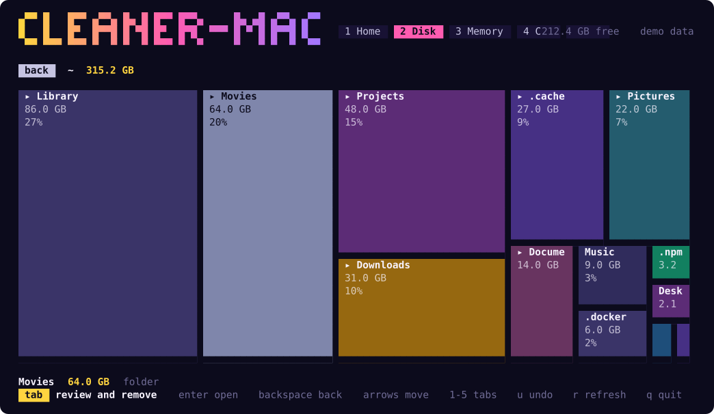
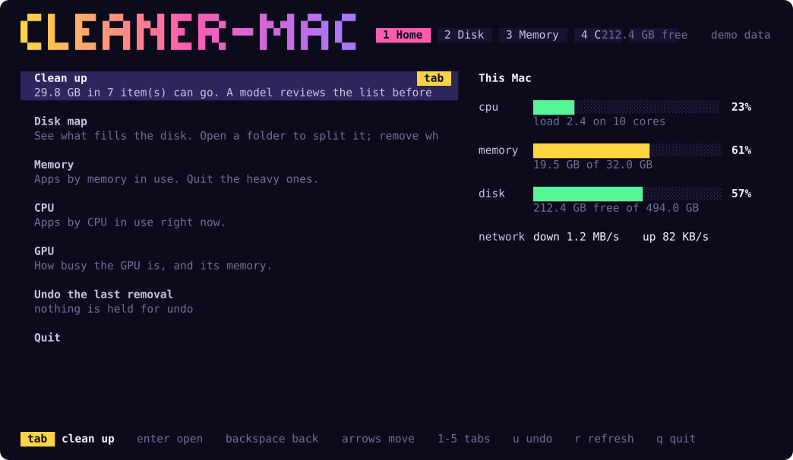
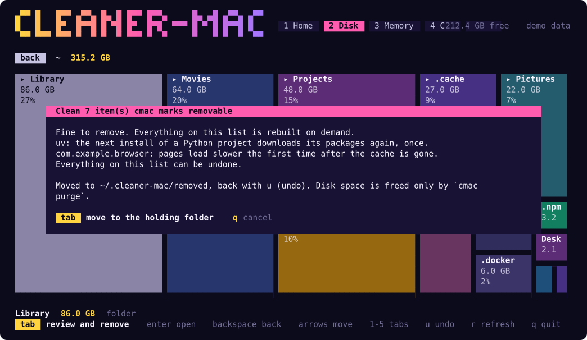

# cleaner-mac

A minimal cleanup and stats tool for macOS, in the terminal. The command is `cmac`.

<p align="center"></p>

Run `cmac` and you get a full-screen view (a TUI). It opens on a Home page of options, with one tab per resource next to it: Disk, Memory, CPU, GPU. Each resource tab is a treemap: every cell is one folder, app or process, and its area is its share of the resource. Open a cell to split it into its parts; press Tab to act on it.

<p align="center"> </p>

The screenshots show `cmac --demo`, which runs the same view on invented data and never reads or removes anything.

- **One file, no dependencies.** `bin/cmac.js` is plain Node. The pixel title is on screen about 50 ms after you press enter, and each check reports on its own line while it runs.
- **Nothing is deleted outright.** Removed files are moved to `~/.cleaner-mac/removed`; `cmac undo` puts them back. Only `cmac purge` deletes, and only when you run it.
- **A model reviews before you agree.** Before anything is removed, the lightest model of Claude Code or Codex reads the list and says what to watch for. Then Tab agrees.
- **Tab is the main button.** Every screen and every prompt has one main action; Tab takes it.
- **Stats for your prompt and status line.** `cmac stats --line` prints CPU, memory, disk and network in one line for zsh, tmux, Neovim and herdr.

## Install

```bash
npm install -g github:Luodian/cleaner-mac
cmac install-skill        # optional: the mac-cleanup skill for Claude Code and Codex
```

Requires macOS and Node 18.15 or newer.

## Use

```bash
cmac                      # the full-screen view
cmac scan                 # the list only; --open shows it as a page, --json for scripts
cmac clean                # model review, then Tab removes; --only <ids> narrows it
cmac undo                 # put the latest removal back
cmac purge                # delete what is held for undo (the only permanent step)
cmac ask                  # a longer look by Claude or Codex, which may read the folders
cmac stats                # CPU, memory, disk, network, battery, busiest processes; --watch refreshes
```

## The full-screen view

| Key | What it does |
|---|---|
| `1` to `5`, or click a tab | Home, Disk, Memory, CPU, GPU |
| arrows, or click | select an option or a cell |
| enter, or click the selected cell | open it into its parts |
| backspace, esc, right click, or the `back` button | go back up; from the top of a tab, back to Home |
| tab | the main action: run the selected option, or act on the selected cell |
| `c` | review and clean everything cmac marks removable |
| `u` | undo the latest removal |
| `r` | measure again |
| `q` | quit |

- **Home** lists what the tool can do (clean up, the four maps, undo) next to CPU, memory, disk and network for this Mac.

- **Disk** starts at your home folder. Each folder is measured on its own, so cells appear as their sizes come in, and sizes are cached (see below). Green cells are on cmac's removable list, amber ones are large personal data. Tab on a cell has the model review it, then moves it to the holding folder. Top-level folders such as `Library` and `Documents` cannot be removed whole: open them and pick something inside.
- **Memory** and **CPU** group processes by app and refresh every 3 seconds. Tab asks an app to quit (as from its menu) or sends a single process the terminate signal, after a confirmation. macOS's own processes and the terminal you are in are refused.
- **GPU** shows how busy the GPU is and its memory. macOS does not report GPU use per process without admin rights, so there is nothing to open or quit there.

## Scanning is kept cheap

Measuring a disk is the expensive part, so the view does as little of it as it can:

- **Cached sizes show at once.** A folder you opened before is drawn from `~/.cache/cleaner-mac/disk.json` the moment you open it again; the corner says how old the numbers are.
- **Nothing is measured again for six hours**, unless you press `r`.
- **A refresh runs at background priority.** When cached sizes are stale they stay on screen and are measured again behind them with `taskpolicy -b du`, which yields CPU and disk to everything else. Only a folder seen for the first time is measured at normal priority, because you are waiting for it.
- **Four measurements at a time, one per entry**, so a huge folder does not hold back the small ones, and only folders you open are ever measured.
- **The removable list is cached the same way**; its slow part is Homebrew's dry run.
- Quitting keeps what was measured so far.

## What it removes

Items come in two groups.

**Can be removed now.** Things that are rebuilt on demand: package-manager caches (uv, npm, pnpm), old Homebrew versions, caches over 300 MB of apps that are not running, logs older than 30 days, temp folders of old Claude sessions. Each row says whether it can be undone and what to watch for. Three of them run a command instead of moving files (`uv cache prune`, `pnpm store prune`, `brew cleanup -s`) and are marked **cannot be undone**.

**Large, needs your decision.** Downloads, Trash, model downloads, virtual machine images, caches of running apps. These are listed with sizes and never removed.

Moving files to the holding folder does not free disk space; `cmac purge` does. Until then the removal costs nothing to reverse.

## The model review

`cmac clean` calls `claude -p --model haiku` or `codex exec` at low reasoning effort, whichever is installed (`--agent` chooses, `CMAC_MODEL` overrides the model). The model gets the list as JSON and no tools; the Claude call also runs without your personal settings, instructions or connected tools. It answers in your system language with a verdict, the items that deserve care, and the ones that cannot be undone. Without a model on PATH `clean` stops and says so; `--no-analysis` skips the review on purpose.

`cmac ask` is the longer version: the default model, allowed to read folders (read-only) to tell you what is inside the large items.

## Stats in your tools

`cmac integration <zsh|tmux|nvim|herdr>` prints the snippet.

| Where | How |
|---|---|
| zsh | `source "$(npm root -g)/cleaner-mac/integrations/cmac.zsh"` puts the line in the right prompt. The prompt never waits: it shows the line written by the previous prompt. |
| tmux | `set -g status-right '#(cmac stats --line)'` |
| Neovim | copy `integrations/cmac.lua` to `~/.config/nvim/lua/`, then `require('cmac').setup()` and use `require('cmac').status` in the status line or lualine. |
| herdr | add `{ token = "cmac" }` to a sidebar row and run `cmac stats --herdr --watch 10`. |

A one-line call takes about 100 ms. CPU and network are rates between two calls, so the first call waits 250 ms for a second sample.

## For agents

`skill/SKILL.md` is a skill for Claude Code and Codex: disk cleanup through `cmac`, a stutter checklist, and login items. `cmac install-skill` links it into `~/.claude/skills` and `~/.agents/skills`. Machine-specific rules go in `~/.config/cleaner-mac/notes.md`, which the skill reads first.

## Adding a rule

Add an entry to `RULES` in `bin/cmac.js`: a `name` and an async `find()` that returns items `{ id, tier, kb, label, detail, note }` with either `paths` (moved to the holding folder, can be undone) or `command` (run as is, cannot be undone). The tool refuses to move anything outside the home folder.

## License

MIT
